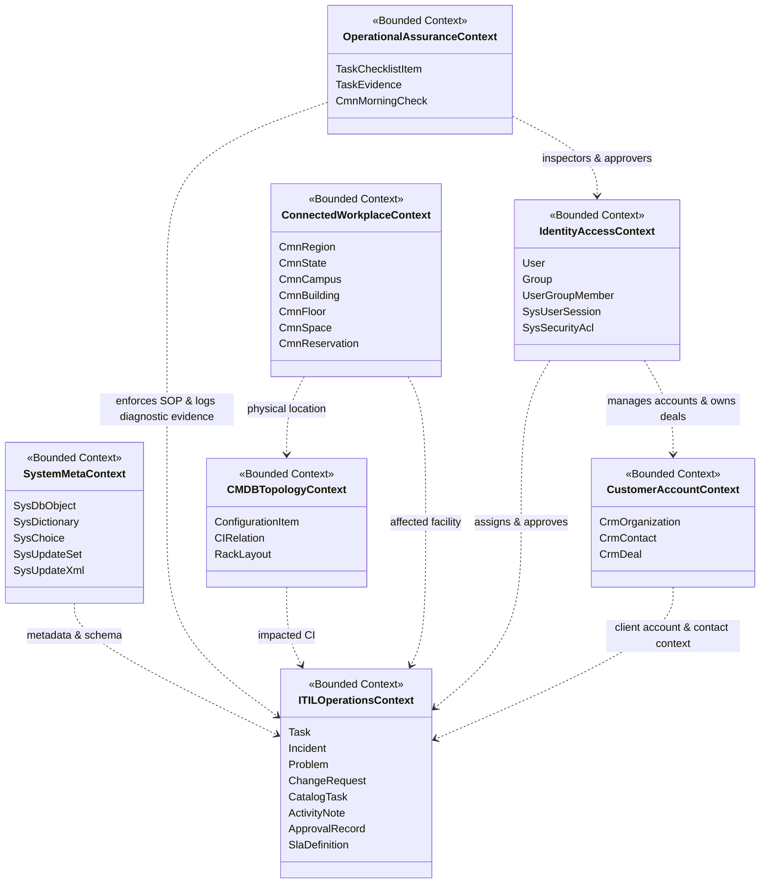

# ServiceMeow Architecture, Topology & Operations Manual (DOKUMENTASI)

**Version**: 1.0.0 (Production / Market-Ready)  
**Standard**: 2026 Enterprise Architecture & Domain-Driven Design (DDD)  
**Scope**: Platform Topology, Bounded Contexts, Directory Layout & Production Runbooks  

---

## 1. System Topology & Tier Boundaries

```mermaid
graph TD
    subgraph Tier1["Tier 1: Client Surfaces (Next.js 15 + React 19)"]
        FulfillerWS["Fulfiller Workspace (/workspace)<br/>• Dockable Multi-Record Tabs<br/>• ITIL Polymorphic Forms<br/>• CMDB Visual Racks<br/>• Purr-Assist AI Panel<br/>• SOP Checklist & Gatekeeper UI<br/>• Hermes Diagnostic Evidence Ledger"]
        StudioIDE["Studio Low-Code IDE (/studio)<br/>• Monaco Code Editor<br/>• Schema Builder (sys_db_object)<br/>• Update Set ALM Engine<br/>• Modular Admin Dynamic Explorer Filtering"]
        SelfService["Self-Service Portal (/portal)<br/>• Service Catalog & Cart<br/>• 6-Tier CAD Workplace Reservations<br/>• 90-Day Uptime Status"]
        SpaceConsole["ServiceMeow Space Console (/workspace/spaces, /studio?tab=workplace)<br/>• 3-Zone Master-Detail Split Console<br/>• Multi-Level Floor Sheet Grid (HQ15-HQ19)<br/>• Room Categories & Organizational Legends<br/>• Layer Highlights & Complex Architectural CAD Stage"]
        WatchtowerCockpit["Watchtower Attention Cockpit (/workspace/watchtower)<br/>• Operational Health Index (0-100)<br/>• 6 High-Urgency Attention Streams<br/>• Critical P1/P2 Incidents & Breaching SLAs"]
        MorningChecks["Morning Checks Console (/workspace/morning-checks)<br/>• Shift Operational Rounds (Morning/Evening/Night)<br/>• Pass/Degraded/Fail Inspection Toggles<br/>• 1-Click P1/P2 Critical Incident Escalation"]
        CrmConsole["Customer Service & CRM Console (/workspace/crm)<br/>• Deal Pipeline Kanban Board (Lead to Won)<br/>• Customer Account 360 Health Scores<br/>• Client Contacts Directory & ARR Tracking"]
    end

    subgraph Tier2["Tier 2: Edge Session & Route Guard (middleware.ts)"]
        EdgeGuard["Edge Route Guard<br/>• Pure Web Crypto HMAC-SHA256 Token Validation<br/>• Sliding Session Renewal<br/>• Identity Header Stripping & Anti-Spoofing<br/>• Role & Persona Route Gating<br/>• Delegated Admin Workspace & Studio Access"]
    end

    subgraph Tier3["Tier 3: Core ITIL Application Services & Sandboxing"]
        TableAPI["Table REST API (/api/now/table/[table])<br/>• Encoded Query Parser & Filter Builder<br/>• Mandatory SOP Checklist Gatekeeper (HTTP 422)<br/>• Hermes Diagnostic Evidence Ledger Ingestion<br/>• Dynamic Reference Resolver<br/>• Audit Delta Logger (sys_audit)<br/>• Delegated Domain Table Bypass"]
        ScriptEngine["QuickJS WASM Script Sandbox<br/>• Isolated Guest Memory (32MB Heap)<br/>• Prototype Pollution Defense<br/>• 1000ms Hard Execution Timeout"]
        FlowEngine["Hermes Workflow Engine<br/>• Trigger Evaluator<br/>• Step Action Runner<br/>• Execution Audit Trail"]
        SpatialService["Connected Workplace Engine<br/>• 6-Tier Hierarchy Traverser<br/>• Architectural CAD Layer Engine (Walls, Columns, Door Swings, Workstations)<br/>• Room Category & Division Allocation Engine<br/>• Double-Booking Conflict Detector"]
        WatchtowerService["Watchtower Intelligence Engine (/api/now/watchtower)<br/>• Multi-Stream Risk Aggregator<br/>• Health Index Algorithm<br/>• Shift Inspection Management (/api/now/morning-checks)"]
        SmartEngines["Smart Automation Engines<br/>• Load-Balancing Task Assignment (src/lib/assignment-engine.ts)<br/>• Quantitative Change Risk & CI Collision Scoring (/api/now/change-risk)<br/>• AI Smart Response Contextual Synthesizer (/api/now/ai/draft-response)"]
    end

    subgraph Tier4["Tier 4: Enterprise Persistence & Background Daemons"]
        PostgresCluster[("PostgreSQL 16 Relational Engine<br/>• 46+ Relational Entities<br/>• Foreign Key Cascade Safety<br/>• Prisma Query Password Hash Omission<br/>• Row Level Security (RLS)")]
        WorkerDaemon["Worker Scheduler Daemon (src/worker.ts)<br/>• 15s Scheduled Job Polling<br/>• Autonomous SLA Escalation Triage<br/>• Background Batch Processor"]
    end

    Tier1 --> Tier2
    Tier2 --> Tier3
    Tier3 --> Tier4
```



---

## 2. Domain-Driven Design (DDD) Bounded Contexts



### Context Isolation Invariants
1. **System Meta Context**: Encapsulates dynamic table definitions and Application Lifecycle Management (ALM). Mutation of `sys_db_object` or `sys_dictionary` triggers cached schema invalidation.
2. **Identity & Access Context**: Sole authority for credential hashing (bcrypt) and session cryptographic signing (HMAC-SHA256). Password hashes are never leaked to external contexts.
3. **ITIL Operations Context**: Manages polymorphic task state machines. All task mutations emit audit deltas (`sys_audit`) and evaluate business rule triggers (`sys_script`).
4. **Operational Assurance Context**: Enforces strict SOP compliance before incident resolution. Mandatory checklist verification halts early closure with HTTP 422. Diagnostic evidence provides tamper-evident audit facts.
5. **Connected Workplace Context**: Maintains strict 6-tier spatial invariant. A Space cannot exist without an enclosing Floor, Building, Campus, State, and Region.
6. **CMDB Topology Context**: Tracks CI lifecycle status and bidirectional graph dependencies (`cmdb_rel_ci`) with cycle detection.
7. **Customer Account Context**: Manages B2B customer organizations, primary contacts, and deal pipelines. Customer health score and contract SLA tiers are projected into ITIL tasks without cross-domain pollution.

---

## 3. Directory Layout & Module Responsibilities

```
servicemeow/
├── .github/workflows/          # CI/CD automated pipeline (PostgreSQL 16 + Vitest + Next.js build)
│   └── ci.yml
├── docs/                       # Architectural documentation, diagrams & visual assets
│   └── assets/                 # System architecture diagrams, screenshots & showcases
├── prisma/                     # Database schemas & seeding harnesses
│   ├── dev.db                  # Local zero-dependency SQLite dev database
│   ├── schema.prisma           # Production PostgreSQL 16 schema (with RLS & indexes)
│   ├── schema.sqlite.prisma    # Developer SQLite schema
│   └── seed.ts                 # Idempotent enterprise seed script (ITIL, Spatial, Users, SOPs)
├── public/                     # Static client assets, SVGs & floorplans
│   └── floorplans/             # Architectural CAD floorplan maps
├── scripts/                    # Platform verification, client generation & headless testing
│   ├── generate-client.js      # Automatic Dual-Schema Prisma client switcher
│   ├── seed-passwords.ts       # Secure cryptographic password generator
│   └── verify-api.ts           # Comprehensive end-to-end REST endpoint test harness
├── src/
│   ├── app/                    # Next.js 15 App Router surfaces & endpoints
│   │   ├── api/                # 85+ REST endpoints
│   │   │   ├── auth/           # Login, logout, me, impersonation
│   │   │   ├── custom/         # User-defined custom scripted REST endpoints
│   │   │   ├── health/         # System uptime & database connection health check
│   │   │   └── now/            # Table API, Watchtower, Morning Checks, CMDB, Spatial, ACLs, Flows, Change Risk, AI Draft
│   │   ├── login/              # Secure authentication entry point
│   │   ├── portal/             # Employee Self-Service intake, reservations & status
│   │   ├── studio/             # 2-Pane Low-Code Configuration Center & Monaco IDE
│   │   ├── workspace/          # Multi-record dockable fulfiller workspace, Watchtower, Morning Checks, CRM Console
│   │   └── layout.tsx          # Root platform shell with theme & identity context
│   ├── components/             # Reusable UI component libraries
│   │   ├── agile/              # Visual sprint & Kanban board components
│   │   ├── cmdb/               # Dependency graph topology & 42U rack visualizer
│   │   ├── common/             # Accessible dialogs, buttons, dropdowns & badges
│   │   ├── studio/             # Monaco editor workbench, schema builder, update sets
│   │   ├── workplace/          # 3-View reservation engine, SpaceConsole, CadFloorplanEditor & FloorBuildingDimensionsModal
│   │   └── workspace/          # Dockable tab bar, CrmConsole, WatchtowerCockpit, MorningChecksConsole, TaskChecklist, TaskEvidenceLedger, AssetQrLabelModal, FilterBuilder
│   ├── lib/                    # Core business logic engines & security infrastructure
│   │   ├── acl-engine.ts       # Granular RBAC, modular admin domain bypass & table ACLs
│   │   ├── assignment-engine.ts # Automated load-balancing task assignment engine
│   │   ├── auth.ts             # Session management, modular admin verification & passwords
│   │   ├── business-rules.ts   # Before/after database trigger lifecycle engine
│   │   ├── change-risk-engine.ts # Quantitative change risk & CI collision evaluation
│   │   ├── db.ts               # Global Prisma client singleton with passwordHash omission
│   │   ├── flow-engine.ts      # Low-code workflow step execution graph
│   │   ├── rate-limiter.ts     # In-memory sliding window rate limiter & lockout guard
│   │   ├── script-sandbox.ts   # QuickJS WebAssembly guest memory sandbox
│   │   ├── sla.ts              # Service Level Agreement calculation & breach engine
│   │   ├── update-set.ts       # ALM package exporter, previewer & conflict detector
│   │   └── workflow-agent.ts   # Autonomous Hermes triage & auto-routing agent
│   ├── middleware.ts           # Edge HMAC-SHA256 session guard, modular admin gates
│   └── worker.ts               # Background 15s scheduler daemon
├── tests/                      # Full Vitest integration test suite (140 passing tests across 19 test files)
├── Dockerfile                  # Multi-stage production container runner
├── docker-compose.yml          # Production PostgreSQL 16 + Web App + Worker stack
├── package.json                # Project dependencies & operational npm scripts
└── tsconfig.json               # Strict TypeScript configuration
```

### 3.1 Swiss Grid Design & Typography System (v3.0.0)
The user interface adheres to the **International Typographic Style (Swiss Grid)** for radical clarity, accessibility, and high contrast:
- **Baseline Mathematical Grid**: Strictly aligned modular grid with crisp 1px solid structural rules (`#E5E5E5` / `#0A0A0A`).
- **Typographic Hierarchy**: High-contrast, clean sans-serif typography with generous line-height and bold numerical eyebrows (`01 /`, `02 /`, `03 /`, `04 /`).
- **First-Time User Accessibility**: Clean, uncluttered 4-quadrant primary action cards designed so a user who has never touched a computer can immediately navigate and solve their issue without training.
- **Color Palette Discipline**: Pure architectural white `#FFFFFF` / stark dark mode `#0A0A0A`, neutral slate structural dividers, and singular focal cues in International Swiss Red (`#EB0029`) and Swiss Precision Blue (`#0047FF`).

---

## 4. Production Deployment & Operational Runbooks

### 4.1 Production Deployment via Docker Compose
To boot the full production stack:
```bash
# 1. Generate 32+ character authentication secret
export AUTH_SECRET=$(openssl rand -base64 32)
export POSTGRES_PASSWORD=$(openssl rand -base64 24)

# 2. Boot PostgreSQL 16, ServiceMeow Web Container, and Background Worker
docker compose up -d --build

# 3. Verify health status
curl -i http://localhost:3000/api/health
```

### 4.2 Zero-Downtime Database Migration Runbook
1. Prepare migration script using Prisma:
   ```bash
   npx prisma migrate dev --name <migration_name> --schema=prisma/schema.prisma
   ```
2. Apply migration to staging/production cluster:
   ```bash
   npx prisma migrate deploy --schema=prisma/schema.prisma
   ```
3. Regenerate client if columns changed:
   ```bash
   node scripts/generate-client.js
   ```

### 4.3 Database Seeding & Development Setup Runbook
```bash
# Generate Prisma Client matching local environment
node scripts/generate-client.js

# Push schema to SQLite database (prisma/dev.db)
DATABASE_URL="file:./dev.db" npx prisma db push --schema=prisma/schema.sqlite.prisma

# Execute idempotent enterprise seed
npx tsx prisma/seed.ts

# Execute full regression test suite
npm run test
```

### 4.4 Health Checks & Observability
- **Health Check Endpoint**: `GET /api/health`
  - Returns `200 OK` with JSON payload `{ status: "ok", timestamp: "...", database: "connected" }`.
  - Non-zero failure exits triggering container restart policies within Docker/Kubernetes.
- **Worker Daemon Logs**: Standard output captures structured logs:
  `[TIMESTAMP] [WORKER] [INFO] Executing job: 'Daily Inactivity Auto-Close' (id: ...)`
