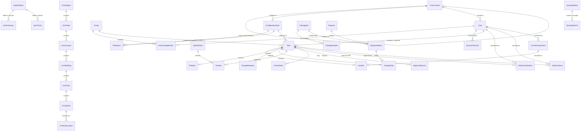

# Entity-Relationship Diagram (ERD) & Database Architecture

**Project**: ServiceMeow Enterprise Service Management  
**Database**: PostgreSQL 16 (Compatible with SQLite for Local Dev)  
**ORM**: Prisma 6.4+  
**Specification Level**: Production DDL + RLS Policies + Foreign Key Cascade Guards  

---

## 1. Visual Entity-Relationship Diagram



---

## 2. Core Relational Domains

### 2.1 System Meta-Schema Domain (The Now Engine)
- **`SysDbObject`**: Core metadata entity cataloging all system and custom (`u_*`) tables.
- **`SysDictionary`**: Column-level dictionary specifying types, mandatory rules, reference target tables, and default values.
- **`SysChoice`**: Picklist options for choice and state fields mapped per table/column.
- **`SysUpdateSet` & `SysUpdateXml`**: Application Lifecycle Management (ALM) tracking schema, form, and script payloads with conflict detection.

### 2.2 Identity & Access Governance Domain
- **`User` (`sys_user`)**: Enterprise identities with bcrypt password hash, primary role (`admin`, `workplace_admin`, `catalog_admin`, `itil_admin`, `cmdb_admin`, `knowledge_admin`, `itil`, `employee`, `cab_approver`), direct secondary roles, and manager hierarchy.
- **`Group` (`sys_user_group`)**: Assignment groups with manager linkages and aggregated roles.
- **`UserGroupMember` (`sys_user_grmember`)**: Many-to-many junction table mapping users to groups.
- **`SysUserSession` (`sys_user_session`)**: Active authenticated sliding sessions with HMAC cryptographic fingerprints and impersonation tracking.
- **`SysSecurityAcl` (`sys_security_acl`)**: Granular operation permissions (`read`, `write`, `create`, `delete`) mapped to roles, supporting delegated domain bypass for modular administrators.

### 2.3 ITIL Task Hierarchy & Operations Domain
- **`Task` (`task`)**: Abstract base task defining number, priority, state, opened/closed timestamps, assigned user, and assignment group.
- **`Incident` (`incident`)**: Incident resolution records with caller references, urgency, impact, subcategory, and resolved metadata.
- **`Problem` (`problem`)**: Root-cause analysis records tracking known errors, workarounds, and permanent fixes.
- **`ChangeRequest` (`change_request`)**: Change management records with risk calculations, CAB review status, planning schedules, and collision checks.
- **`ActivityNote` (`sys_journal_field`)**: Work notes and customer-visible comments with author attribution and audit delta tracking.
- **`ApprovalRecord` (`sys_approval`)**: Approval state machine records linked to tasks, change requests, or catalog requests.
- **`SlaDefinition` & `TaskSla`**: Service Level Agreement definitions and active live breach timer instances.

### 2.4 Connected Workplace & 6-Tier Spatial Domain
- **`CmnRegion`**: Global geographical regions (e.g., "Americas", "EMEA", "APAC").
- **`CmnState`**: State, province, or territory references belonging to a region.
- **`CmnCampus`**: Physical real estate campuses with geographical coordinates (latitude/longitude) and street addresses.
- **`CmnBuilding`**: Physical buildings with classification (`hospital`, `clinic`, `office`, `datacenter`) and floor counts.
- **`CmnFloor`**: Building levels with CAD SVG schematic URLs (`floorplanSvgUrl`), floorplan image assets (`floorplanImageUrl`), and total square footage.
- **`CmnSpace`**: Granular rooms, surgical suites, huddle pods, and hot desks with normalized SVG hotspot coordinates (`floorplanX`, `floorplanY`, `floorplanWidth`, `floorplanHeight`) and amenity capabilities.
- **`CmnReservation`**: Scheduled space bookings with start/end time windows, attendee count, and status state machine (`confirmed`, `checked_in`, `cancelled`).
- **`CmnLocation`**: Unified legacy location table providing multi-tier breadcrumb pathing for assets and user profiles.

### 2.5 CMDB & Configuration Management Domain
- **`ConfigurationItem` (`cmdb_ci`)**: Configuration items across business services, servers, network switches, racks, and databases.
- **`CIRelation` (`cmdb_rel_ci`)**: Upstream and downstream dependency relationships (`Depends on::Used by`, `Runs on::Hosts`).

### 2.6 Space Console & Architectural CAD Allocation Domain (v2.0.0)
- **`CmnSpaceCategory` (`cmn_space_category`)**: Standard architectural space classifications (`MEETING`, `OFFICE`, `OPENPLAN`, `PRIMCIRC`, `SECONDCIRC`, `SERV`, `SUPPORT`, `VERT`, `WKSTN`) with legend color hex, description, and standard capacity.
- **`CmnDepartment` (`cmn_department`)**: Corporate divisions and organizational business units (e.g. `Electronic Systems`, `Executive Leadership`, `Cloud Infrastructure`) with cost centers and headcount.
- **`CmnDrawing` (`cmn_drawing`)**: Architectural CAD drawing sheets (e.g. `hq18`, `tt_l4`, `offcen01`) with vector layer metadata, drawing title, total gross square footage, and floor linkages.

### 2.7 Operational Assurance & Diagnostic Evidence Domain (v3.2.0)
- **`TaskChecklistItem` (`task_checklist_item`)**: Standard Operating Procedure steps attached to tasks. Defines `isMandatory` validation flags, completion state, completed-by user attribution, and ordering.
- **`TaskEvidence` (`task_evidence`)**: Concrete diagnostic facts (`log.stacktrace`, `ci.ping_failure`, `git.commit_hash`, `monitor.alert`, `crm.thread_reply`) preventing AI or operator hallucination. Includes decisive flags, confidence scores, and operator review lifecycle (`proposed`, `accepted`, `rejected`).
- **`CmnMorningCheck` (`cmn_morning_check`)**: Shift-based recurring operational rounds across infrastructure categories (`datacenter`, `backup`, `network`, `database`, `security`, `application`). Supports tri-state status (`PASS`, `DEGRADED`, `FAIL`, `PENDING`), inspector attribution, and 1-click critical incident escalation.

---

## 3. Production PostgreSQL DDL

```sql
-- Enable UUID and Cryptographic Extensions
CREATE EXTENSION IF NOT EXISTS "uuid-ossp";
CREATE EXTENSION IF NOT EXISTS "pgcrypto";

-- ==============================================================================
-- 1. Identity & RBAC
-- ==============================================================================

CREATE TABLE IF NOT EXISTS sys_user (
    id VARCHAR(36) PRIMARY KEY DEFAULT gen_random_uuid()::text,
    user_name VARCHAR(100) UNIQUE,
    email VARCHAR(255) UNIQUE NOT NULL,
    password_hash VARCHAR(255),
    name VARCHAR(255) NOT NULL,
    title VARCHAR(150),
    department VARCHAR(150),
    role VARCHAR(50) DEFAULT 'employee' NOT NULL,
    roles TEXT DEFAULT '',
    active BOOLEAN DEFAULT TRUE NOT NULL,
    avatar VARCHAR(500),
    manager_id VARCHAR(36) REFERENCES sys_user(id) ON DELETE SET NULL,
    location_id VARCHAR(36),
    created_at TIMESTAMP WITH TIME ZONE DEFAULT CURRENT_TIMESTAMP NOT NULL,
    updated_at TIMESTAMP WITH TIME ZONE DEFAULT CURRENT_TIMESTAMP NOT NULL
);

CREATE INDEX idx_sys_user_email ON sys_user(email);
CREATE INDEX idx_sys_user_role ON sys_user(role);
CREATE INDEX idx_sys_user_manager ON sys_user(manager_id);

CREATE TABLE IF NOT EXISTS sys_user_group (
    id VARCHAR(36) PRIMARY KEY DEFAULT gen_random_uuid()::text,
    name VARCHAR(150) UNIQUE NOT NULL,
    description TEXT,
    active BOOLEAN DEFAULT TRUE NOT NULL,
    manager_id VARCHAR(36) REFERENCES sys_user(id) ON DELETE SET NULL,
    roles TEXT DEFAULT '',
    created_at TIMESTAMP WITH TIME ZONE DEFAULT CURRENT_TIMESTAMP NOT NULL
);

CREATE TABLE IF NOT EXISTS sys_user_grmember (
    id VARCHAR(36) PRIMARY KEY DEFAULT gen_random_uuid()::text,
    user_id VARCHAR(36) NOT NULL REFERENCES sys_user(id) ON DELETE CASCADE,
    group_id VARCHAR(36) NOT NULL REFERENCES sys_user_group(id) ON DELETE CASCADE,
    created_at TIMESTAMP WITH TIME ZONE DEFAULT CURRENT_TIMESTAMP NOT NULL,
    CONSTRAINT uq_user_group UNIQUE (user_id, group_id)
);

CREATE INDEX idx_grmember_user ON sys_user_grmember(user_id);
CREATE INDEX idx_grmember_group ON sys_user_grmember(group_id);

CREATE TABLE IF NOT EXISTS sys_user_session (
    id VARCHAR(36) PRIMARY KEY DEFAULT gen_random_uuid()::text,
    user_id VARCHAR(36) NOT NULL REFERENCES sys_user(id) ON DELETE CASCADE,
    token VARCHAR(255) UNIQUE NOT NULL,
    ip_address VARCHAR(45),
    user_agent TEXT,
    impersonator_id VARCHAR(36) REFERENCES sys_user(id) ON DELETE SET NULL,
    expires_at TIMESTAMP WITH TIME ZONE NOT NULL,
    created_at TIMESTAMP WITH TIME ZONE DEFAULT CURRENT_TIMESTAMP NOT NULL
);

CREATE INDEX idx_session_token ON sys_user_session(token);
CREATE INDEX idx_session_expires ON sys_user_session(expires_at);

-- ==============================================================================
-- 2. Spatial Hierarchy & Connected Workplace
-- ==============================================================================

CREATE TABLE IF NOT EXISTS cmn_region (
    id VARCHAR(36) PRIMARY KEY DEFAULT gen_random_uuid()::text,
    name VARCHAR(150) NOT NULL,
    code VARCHAR(50) UNIQUE NOT NULL,
    description TEXT,
    active BOOLEAN DEFAULT TRUE NOT NULL,
    created_at TIMESTAMP WITH TIME ZONE DEFAULT CURRENT_TIMESTAMP NOT NULL,
    updated_at TIMESTAMP WITH TIME ZONE DEFAULT CURRENT_TIMESTAMP NOT NULL
);

CREATE TABLE IF NOT EXISTS cmn_state (
    id VARCHAR(36) PRIMARY KEY DEFAULT gen_random_uuid()::text,
    name VARCHAR(150) NOT NULL,
    code VARCHAR(50) NOT NULL,
    country VARCHAR(100) DEFAULT 'US',
    region_id VARCHAR(36) REFERENCES cmn_region(id) ON DELETE SET NULL,
    created_at TIMESTAMP WITH TIME ZONE DEFAULT CURRENT_TIMESTAMP NOT NULL,
    updated_at TIMESTAMP WITH TIME ZONE DEFAULT CURRENT_TIMESTAMP NOT NULL,
    CONSTRAINT uq_state_region_code UNIQUE (region_id, code)
);

CREATE TABLE IF NOT EXISTS cmn_campus (
    id VARCHAR(36) PRIMARY KEY DEFAULT gen_random_uuid()::text,
    name VARCHAR(200) NOT NULL,
    code VARCHAR(50) UNIQUE NOT NULL,
    state_id VARCHAR(36) REFERENCES cmn_state(id) ON DELETE SET NULL,
    address VARCHAR(255),
    city VARCHAR(100),
    zip_code VARCHAR(20),
    latitude DOUBLE PRECISION,
    longitude DOUBLE PRECISION,
    created_at TIMESTAMP WITH TIME ZONE DEFAULT CURRENT_TIMESTAMP NOT NULL,
    updated_at TIMESTAMP WITH TIME ZONE DEFAULT CURRENT_TIMESTAMP NOT NULL
);

CREATE TABLE IF NOT EXISTS cmn_building (
    id VARCHAR(36) PRIMARY KEY DEFAULT gen_random_uuid()::text,
    name VARCHAR(200) NOT NULL,
    code VARCHAR(50) NOT NULL,
    campus_id VARCHAR(36) REFERENCES cmn_campus(id) ON DELETE SET NULL,
    building_type VARCHAR(50) DEFAULT 'office',
    floors_count INT DEFAULT 1,
    total_area_sq_ft DOUBLE PRECISION,
    created_at TIMESTAMP WITH TIME ZONE DEFAULT CURRENT_TIMESTAMP NOT NULL,
    updated_at TIMESTAMP WITH TIME ZONE DEFAULT CURRENT_TIMESTAMP NOT NULL,
    CONSTRAINT uq_bldg_campus_code UNIQUE (campus_id, code)
);

CREATE TABLE IF NOT EXISTS cmn_floor (
    id VARCHAR(36) PRIMARY KEY DEFAULT gen_random_uuid()::text,
    name VARCHAR(200) NOT NULL,
    floor_number INT NOT NULL,
    code VARCHAR(50) NOT NULL,
    building_id VARCHAR(36) REFERENCES cmn_building(id) ON DELETE SET NULL,
    floorplan_svg_url VARCHAR(500),
    floorplan_image_url VARCHAR(500),
    area_sq_ft DOUBLE PRECISION,
    created_at TIMESTAMP WITH TIME ZONE DEFAULT CURRENT_TIMESTAMP NOT NULL,
    updated_at TIMESTAMP WITH TIME ZONE DEFAULT CURRENT_TIMESTAMP NOT NULL,
    CONSTRAINT uq_floor_bldg_code UNIQUE (building_id, code)
);

CREATE TABLE IF NOT EXISTS cmn_space (
    id VARCHAR(36) PRIMARY KEY DEFAULT gen_random_uuid()::text,
    name VARCHAR(200) NOT NULL,
    space_number VARCHAR(50) NOT NULL,
    floor_id VARCHAR(36) REFERENCES cmn_floor(id) ON DELETE SET NULL,
    space_type VARCHAR(50) DEFAULT 'room' NOT NULL,
    status VARCHAR(50) DEFAULT 'available' NOT NULL,
    capacity INT DEFAULT 1,
    square_feet DOUBLE PRECISION,
    department VARCHAR(100),
    capabilities JSONB,
    image_url VARCHAR(500),
    floorplan_x DOUBLE PRECISION,
    floorplan_y DOUBLE PRECISION,
    floorplan_width DOUBLE PRECISION,
    floorplan_height DOUBLE PRECISION,
    svg_element_id VARCHAR(100),
    created_at TIMESTAMP WITH TIME ZONE DEFAULT CURRENT_TIMESTAMP NOT NULL,
    updated_at TIMESTAMP WITH TIME ZONE DEFAULT CURRENT_TIMESTAMP NOT NULL,
    CONSTRAINT uq_space_floor_number UNIQUE (floor_id, space_number)
);

CREATE INDEX idx_cmn_space_floor ON cmn_space(floor_id);
CREATE INDEX idx_cmn_space_status ON cmn_space(status);

CREATE TABLE IF NOT EXISTS cmn_reservation (
    id VARCHAR(36) PRIMARY KEY DEFAULT gen_random_uuid()::text,
    number VARCHAR(50) UNIQUE NOT NULL,
    space_id VARCHAR(36) NOT NULL REFERENCES cmn_space(id) ON DELETE CASCADE,
    reserved_by_id VARCHAR(36) NOT NULL REFERENCES sys_user(id) ON DELETE CASCADE,
    start_time TIMESTAMP WITH TIME ZONE NOT NULL,
    end_time TIMESTAMP WITH TIME ZONE NOT NULL,
    status VARCHAR(50) DEFAULT 'confirmed' NOT NULL,
    purpose VARCHAR(255),
    attendees_count INT DEFAULT 1,
    created_at TIMESTAMP WITH TIME ZONE DEFAULT CURRENT_TIMESTAMP NOT NULL,
    updated_at TIMESTAMP WITH TIME ZONE DEFAULT CURRENT_TIMESTAMP NOT NULL
);

CREATE INDEX idx_res_space_time ON cmn_reservation(space_id, start_time, end_time);
CREATE INDEX idx_res_user ON cmn_reservation(reserved_by_id);

-- ==============================================================================
-- 3. Polymorphic ITIL Task Engine
-- ==============================================================================

CREATE TABLE IF NOT EXISTS task (
    id VARCHAR(36) PRIMARY KEY DEFAULT gen_random_uuid()::text,
    number VARCHAR(50) UNIQUE NOT NULL,
    sys_class_name VARCHAR(50) NOT NULL,
    short_description VARCHAR(255) NOT NULL,
    description TEXT,
    priority INT DEFAULT 3 NOT NULL,
    state INT DEFAULT 1 NOT NULL,
    opened_by_id VARCHAR(36) REFERENCES sys_user(id) ON DELETE SET NULL,
    assigned_to_id VARCHAR(36) REFERENCES sys_user(id) ON DELETE SET NULL,
    assignment_group_id VARCHAR(36) REFERENCES sys_user_group(id) ON DELETE SET NULL,
    cmdb_ci_id VARCHAR(36),
    opened_at TIMESTAMP WITH TIME ZONE DEFAULT CURRENT_TIMESTAMP NOT NULL,
    closed_at TIMESTAMP WITH TIME ZONE,
    created_at TIMESTAMP WITH TIME ZONE DEFAULT CURRENT_TIMESTAMP NOT NULL,
    updated_at TIMESTAMP WITH TIME ZONE DEFAULT CURRENT_TIMESTAMP NOT NULL
);

CREATE INDEX idx_task_number ON task(number);
CREATE INDEX idx_task_assigned_to ON task(assigned_to_id);
CREATE INDEX idx_task_group ON task(assignment_group_id);
CREATE INDEX idx_task_state_priority ON task(state, priority);

CREATE TABLE IF NOT EXISTS incident (
    id VARCHAR(36) PRIMARY KEY DEFAULT gen_random_uuid()::text,
    task_id VARCHAR(36) UNIQUE NOT NULL REFERENCES task(id) ON DELETE CASCADE,
    caller_id VARCHAR(36) REFERENCES sys_user(id) ON DELETE SET NULL,
    category VARCHAR(100),
    subcategory VARCHAR(100),
    urgency INT DEFAULT 3 NOT NULL,
    impact INT DEFAULT 3 NOT NULL,
    close_code VARCHAR(100),
    close_notes TEXT,
    resolved_at TIMESTAMP WITH TIME ZONE,
    resolved_by_id VARCHAR(36) REFERENCES sys_user(id) ON DELETE SET NULL
);

CREATE TABLE IF NOT EXISTS change_request (
    id VARCHAR(36) PRIMARY KEY DEFAULT gen_random_uuid()::text,
    task_id VARCHAR(36) UNIQUE NOT NULL REFERENCES task(id) ON DELETE CASCADE,
    change_type VARCHAR(50) DEFAULT 'normal' NOT NULL,
    risk INT DEFAULT 3 NOT NULL,
    scope VARCHAR(50) DEFAULT 'departmental',
    start_date TIMESTAMP WITH TIME ZONE,
    end_date TIMESTAMP WITH TIME ZONE,
    cab_required BOOLEAN DEFAULT FALSE NOT NULL,
    cab_recommendation TEXT,
    justification TEXT,
    implementation_plan TEXT,
    backout_plan TEXT,
    test_plan TEXT
);

CREATE TABLE IF NOT EXISTS sys_activity_note (
    id VARCHAR(36) PRIMARY KEY DEFAULT gen_random_uuid()::text,
    task_id VARCHAR(36) NOT NULL REFERENCES task(id) ON DELETE CASCADE,
    author_id VARCHAR(36) REFERENCES sys_user(id) ON DELETE SET NULL,
    note_type VARCHAR(50) DEFAULT 'work_note' NOT NULL,
    content TEXT NOT NULL,
    field_changes JSONB,
    created_at TIMESTAMP WITH TIME ZONE DEFAULT CURRENT_TIMESTAMP NOT NULL
);

CREATE INDEX idx_activity_task ON sys_activity_note(task_id, created_at);

-- ----------------------------------------------------
-- Space Console & Architectural CAD Allocation Tables
-- ----------------------------------------------------

CREATE TABLE IF NOT EXISTS cmn_space_category (
    id VARCHAR(36) PRIMARY KEY DEFAULT gen_random_uuid()::text,
    code VARCHAR(50) UNIQUE NOT NULL,
    name VARCHAR(100) NOT NULL,
    description TEXT,
    legend_color VARCHAR(20) NOT NULL DEFAULT '#6366f1',
    is_circulation BOOLEAN DEFAULT FALSE,
    active BOOLEAN DEFAULT TRUE,
    created_at TIMESTAMP WITH TIME ZONE DEFAULT CURRENT_TIMESTAMP NOT NULL,
    updated_at TIMESTAMP WITH TIME ZONE DEFAULT CURRENT_TIMESTAMP NOT NULL
);

CREATE TABLE IF NOT EXISTS cmn_department (
    id VARCHAR(36) PRIMARY KEY DEFAULT gen_random_uuid()::text,
    code VARCHAR(50) UNIQUE NOT NULL,
    name VARCHAR(100) NOT NULL,
    division VARCHAR(100),
    headcount INT DEFAULT 0,
    cost_center VARCHAR(50),
    created_at TIMESTAMP WITH TIME ZONE DEFAULT CURRENT_TIMESTAMP NOT NULL,
    updated_at TIMESTAMP WITH TIME ZONE DEFAULT CURRENT_TIMESTAMP NOT NULL
);

CREATE TABLE IF NOT EXISTS cmn_drawing (
    id VARCHAR(36) PRIMARY KEY DEFAULT gen_random_uuid()::text,
    code VARCHAR(50) UNIQUE NOT NULL,
    title VARCHAR(150) NOT NULL,
    floor_id VARCHAR(36) REFERENCES cmn_floor(id) ON DELETE CASCADE,
    file_url VARCHAR(255) NOT NULL,
    layers JSONB,
    total_area_sqft NUMERIC(10, 2),
    created_at TIMESTAMP WITH TIME ZONE DEFAULT CURRENT_TIMESTAMP NOT NULL,
    updated_at TIMESTAMP WITH TIME ZONE DEFAULT CURRENT_TIMESTAMP NOT NULL
);

CREATE INDEX idx_drawing_floor ON cmn_drawing(floor_id);

-- ==============================================================================
-- 7. Operational Assurance & Diagnostic Evidence (v3.2.0)
-- ==============================================================================

CREATE TABLE IF NOT EXISTS task_checklist_item (
    id VARCHAR(36) PRIMARY KEY DEFAULT gen_random_uuid()::text,
    task_id VARCHAR(36) NOT NULL,
    title VARCHAR(255) NOT NULL,
    description TEXT,
    is_mandatory BOOLEAN DEFAULT FALSE NOT NULL,
    is_completed BOOLEAN DEFAULT FALSE NOT NULL,
    completed_by_id VARCHAR(36),
    completed_at TIMESTAMP WITH TIME ZONE,
    sort_order INTEGER DEFAULT 0 NOT NULL,
    created_at TIMESTAMP WITH TIME ZONE DEFAULT CURRENT_TIMESTAMP NOT NULL,
    updated_at TIMESTAMP WITH TIME ZONE DEFAULT CURRENT_TIMESTAMP NOT NULL,
    CONSTRAINT fk_checklist_task FOREIGN KEY (task_id) REFERENCES task(id) ON DELETE CASCADE,
    CONSTRAINT fk_checklist_user FOREIGN KEY (completed_by_id) REFERENCES sys_user(id) ON DELETE SET NULL
);

CREATE INDEX idx_checklist_task_gate ON task_checklist_item(task_id, is_mandatory, is_completed);

CREATE TABLE IF NOT EXISTS task_evidence (
    id VARCHAR(36) PRIMARY KEY DEFAULT gen_random_uuid()::text,
    task_id VARCHAR(36) NOT NULL,
    claim_field VARCHAR(100) NOT NULL,
    claim_value TEXT NOT NULL,
    evidence_kind VARCHAR(50) NOT NULL,
    is_decisive BOOLEAN DEFAULT FALSE NOT NULL,
    raw_observation TEXT NOT NULL,
    source_url VARCHAR(500),
    status VARCHAR(20) DEFAULT 'proposed' NOT NULL,
    decided_by_id VARCHAR(36),
    decided_at TIMESTAMP WITH TIME ZONE,
    created_at TIMESTAMP WITH TIME ZONE DEFAULT CURRENT_TIMESTAMP NOT NULL,
    updated_at TIMESTAMP WITH TIME ZONE DEFAULT CURRENT_TIMESTAMP NOT NULL,
    CONSTRAINT fk_evidence_task FOREIGN KEY (task_id) REFERENCES task(id) ON DELETE CASCADE,
    CONSTRAINT fk_evidence_user FOREIGN KEY (decided_by_id) REFERENCES sys_user(id) ON DELETE SET NULL
);

CREATE INDEX idx_evidence_task_status ON task_evidence(task_id, status);

CREATE TABLE IF NOT EXISTS cmn_morning_check (
    id VARCHAR(36) PRIMARY KEY DEFAULT gen_random_uuid()::text,
    title VARCHAR(255) NOT NULL,
    category VARCHAR(50) NOT NULL,
    target_system VARCHAR(100) NOT NULL,
    shift VARCHAR(20) DEFAULT 'morning' NOT NULL,
    status VARCHAR(20) DEFAULT 'pending' NOT NULL,
    notes TEXT,
    checked_by_id VARCHAR(36),
    checked_at TIMESTAMP WITH TIME ZONE,
    incident_id VARCHAR(36),
    created_at TIMESTAMP WITH TIME ZONE DEFAULT CURRENT_TIMESTAMP NOT NULL,
    updated_at TIMESTAMP WITH TIME ZONE DEFAULT CURRENT_TIMESTAMP NOT NULL,
    CONSTRAINT fk_morning_check_user FOREIGN KEY (checked_by_id) REFERENCES sys_user(id) ON DELETE SET NULL,
    CONSTRAINT fk_morning_check_incident FOREIGN KEY (incident_id) REFERENCES incident(id) ON DELETE SET NULL
);

CREATE INDEX idx_morning_check_cat_status ON cmn_morning_check(category, status, created_at);
```

---

## 4. Row Level Security (RLS) Policies

To enforce multi-tenant persona segregation at the database engine tier, PostgreSQL Row Level Security (RLS) policies are configured as follows:

```sql
-- Enable RLS on core tables
ALTER TABLE task ENABLE ROW LEVEL SECURITY;
ALTER TABLE sys_user ENABLE ROW LEVEL SECURITY;
ALTER TABLE sys_user_session ENABLE ROW LEVEL SECURITY;
ALTER TABLE cmn_reservation ENABLE ROW LEVEL SECURITY;
ALTER TABLE task_checklist_item ENABLE ROW LEVEL SECURITY;
ALTER TABLE task_evidence ENABLE ROW LEVEL SECURITY;
ALTER TABLE cmn_morning_check ENABLE ROW LEVEL SECURITY;

-- 1. Session & Identity Policy: Users can only inspect their own session records (admins see all)
CREATE POLICY user_session_isolation ON sys_user_session
    FOR ALL
    USING (
        current_setting('request.jwt.claim.role', true) = 'admin'
        OR user_id = current_setting('request.jwt.claim.sub', true)
    );

-- 2. ITIL Task Policy: Fulfillers and admins see all tasks; employees only see tasks they opened or are caller of
CREATE POLICY task_role_isolation ON task
    FOR SELECT
    USING (
        current_setting('request.jwt.claim.role', true) IN ('admin', 'itil', 'cab_approver')
        OR opened_by_id = current_setting('request.jwt.claim.sub', true)
    );

-- 3. Task Mutation Policy: Only ITIL fulfillers and admins may mutate tasks
CREATE POLICY task_mutation_guard ON task
    FOR UPDATE
    USING (
        current_setting('request.jwt.claim.role', true) IN ('admin', 'itil')
    );

-- 4. Reservation Policy: Users can view all confirmed reservations; mutations restricted to reservation owner or admin
CREATE POLICY reservation_select_all ON cmn_reservation
    FOR SELECT
    USING (true);

CREATE POLICY reservation_mutation_guard ON cmn_reservation
    FOR UPDATE
    USING (
        current_setting('request.jwt.claim.role', true) = 'admin'
        OR reserved_by_id = current_setting('request.jwt.claim.sub', true)
    );

-- 5. Checklist Policy: Fulfillers mutate; callers can read items for their tickets
CREATE POLICY checklist_select ON task_checklist_item
    FOR SELECT
    USING (
        current_setting('request.jwt.claim.role', true) IN ('admin', 'itil', 'cab_approver')
        OR EXISTS (SELECT 1 FROM task WHERE task.id = task_checklist_item.task_id AND task.opened_by_id = current_setting('request.jwt.claim.sub', true))
    );

CREATE POLICY checklist_mutation_guard ON task_checklist_item
    FOR ALL
    USING (
        current_setting('request.jwt.claim.role', true) IN ('admin', 'itil')
    );

-- 6. Evidence & Morning Checks Policy: Restricted to ITIL operations and administrators
CREATE POLICY evidence_access_guard ON task_evidence
    FOR ALL
    USING (
        current_setting('request.jwt.claim.role', true) IN ('admin', 'itil')
    );

CREATE POLICY morning_checks_guard ON cmn_morning_check
    FOR ALL
    USING (
        current_setting('request.jwt.claim.role', true) IN ('admin', 'itil')
    );
```
