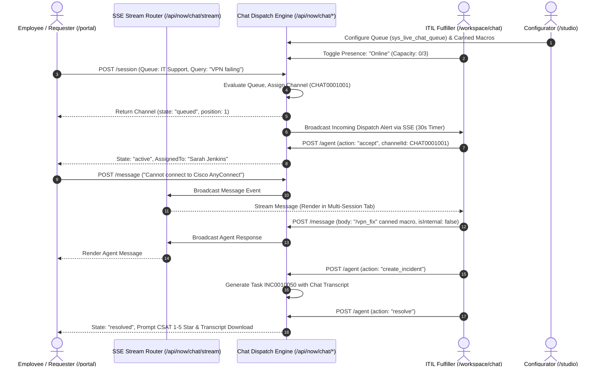

# Product Requirements Document (PRD)

**Project**: ServiceMeow — Enterprise Service Management (ESM) & Autonomous ITIL Operations Platform  
**Version**: 3.5.0 (Omnichannel Live Agent Chat System, Real-Time SSE Dispatch Engine & Studio Chat Console)  
**Status**: Production Ready & Fully Tested  
**Created**: 2026-10-14  
**Last Updated**: 2026-10-22  

---

## 1. Executive Summary
ServiceMeow is an open-source, high-performance Enterprise Service Management (ESM) and ITIL operations platform engineered with Next.js 15 (App Router), React 19, TypeScript, Tailwind CSS, Prisma ORM, and QuickJS WebAssembly sandboxing. It replaces legacy, high-latency enterprise service suites with a sub-second, dockable multi-record workspace, a 6-tier Connected Workplace spatial CAD floorplan booking engine, low-code studio development with Update Set ALM, a deterministic Watchtower attention cockpit, mandatory SOP gatekeeper verification, shift morning checks operational rounds, an autonomous background triage daemon, Customer 360 CRM accounts with deal pipelines, load-balancing task assignment, quantitative change risk scoring, and a real-time omnichannel Live Agent Chat system supporting Requestor self-service, Fulfiller cockpit multi-session triage, intelligent capacity-aware queue routing, and Studio administrative configuration.

---

## 2. Problem Statement
**Problem**: Traditional enterprise IT operations and service desks suffer from prohibitive licensing costs, sluggish multi-tab navigation, brittle JavaScript execution models with process escape vulnerabilities, fractured workplace facility reservation tools, siloed customer account information separated from service tickets, arbitrary unquantified change approvals, and lack of deterministic attention management for critical operational risks.  
**Target Users**:
1. **ITIL Fulfillers & Engineers**: Incident responders, change managers, and service desk analysts needing high-throughput multi-record triage without page reloading.
2. **Platform Administrators & Low-Code Developers**: System architects building custom schemas, business rules, client scripts, and deploying configuration updates across environments.
3. **Enterprise Employees & Requesters**: Knowledge workers submitting service requests, reserving hybrid desks/rooms, and verifying platform availability.
4. **Facility & Workplace Directors**: Operations managers monitoring real-time occupancy, interactive floorplans, and room amenities.
5. **NOC / SOC Operations Commanders**: Shift leads performing daily operational rounds, enforcing SOP compliance before resolution, and tracking aggregate system health.
6. **Customer Success & Account Managers**: Commercial and support managers tracking client accounts, SLAs, deal stages, and customer contacts.

**Current Pain Points**:
- Multi-second navigation latencies when juggling multiple incidents and change tickets.
- Security vulnerabilities in server-side script runners prone to prototype pollution and sandbox escaping.
- Lack of unified spatial hierarchy linking physical hardware (CMDB) to precise campus/building/floor/room coordinates.
- Absence of transparent 90-day component uptime reporting tied directly to underlying incident records.
- Premature ticket closures without verifying critical Standard Operating Procedures (SOPs).
- Hallucinated or unverified diagnostic claims lacking concrete cryptographic or machine-generated log evidence.
- Disconnected CRM data leading to blind incident handling without account SLA tier or health score visibility.
- Manual and skewed ticket distribution overloading individual engineers.
- Subjective change risk evaluations resulting in undetected change collisions on mission-critical CIs.

---

## 3. Goals & Success Metrics
| Goal | Metric | Target |
|---|---|---|
| Zero-Lag Multitasking | Workspace Tab Switching Latency | < 16ms (60 FPS fluid rendering) |
| High-Throughput REST APIs | Table API (`/api/now/table/[table]`) p95 | < 80ms under 500 req/sec |
| Rust CAD Vector Decomposition | Floorplan polygon parsing throughput | > 300,000 blueprints/sec (verified 346,012/sec) |
| Rust Telemetry Ingestion Pipeline | In-memory ring buffer throughput | > 2,000,000 events/sec (verified 2,303,609/sec) |
| Secure Script Sandboxing | Execution memory ceiling & runtime isolation | 32MB WASM heap, 1000ms hard timeout |
| Spatial Hierarchy Integrity | Breadcrumb path resolution across 6 tiers | 100% relational referential integrity |
| SOP Resolution Integrity | Mandatory checklist enforcement | 100% block rate (HTTP 422) on incomplete items |
| Operational Attention | Watchtower health score & attention stream refresh | Real-time deterministic aggregation |
| Automated Load Balancing | Ticket assignment skew among active group members | Deviation < 1 open ticket |
| Quantitative Change Risk | Conflict and duration risk scoring accuracy | 100% detection of overlapping CI change windows |
| Live Chat SSE Delivery Latency | Message delivery across SSE event stream | < 40ms end-to-end |
| Queue Dispatch & Assignment Latency | Agent intake notification dispatch | < 100ms from requester queue join |
| Live Chat Capacity Enforcement | Concurrent chats per active fulfiller | Strict limit (e.g. max 3 chats) |
| Vitest Test Coverage | Next.js & TypeScript regression test suite | 100% passing |
| Rust Core Engine Tests | Cargo integration test suite | 100% passing (6 integration tests) |
| Production Build Reliability | Next.js compilation & TypeScript type-check | 0 errors, 0 unresolved imports |

---

## 4. User Personas & Role-Based Access Control (RBAC)

### Persona 1: Sarah Jenkins — Lead Fulfiller / Incident Commander
- **Role**: `itil`
- **Surface**: `/workspace`
- **Goals**: Rapidly triage P1/P2 incidents, coordinate change management approvals, inspect CMDB dependency topology, and invoke Purr-Assist AI for ticket handoffs.
- **Key Behaviors**: Keeps 5-10 tabs open concurrently in the Dockable Tab Bar; inspects live SLA timers.

### Persona 2: Alex Chen — Platform Administrator & Studio Architect
- **Role**: `admin`
- **Surface**: `/studio`
- **Goals**: Define data dictionaries (`sys_db_object`, `sys_dictionary`), create business rules (`sys_script`), configure Flow Engine automations, and manage Update Set releases.
- **Key Behaviors**: Uses Monaco editor for sandboxed scripts; inspects collision detection prior to Update Set commit.

### Persona 3: Taylor Reed — Corporate Employee / Requester
- **Role**: `employee`
- **Surface**: `/portal`
- **Goals**: Browse the Service Catalog, order equipment via shopping cart checkout, submit record producers, reserve desks/rooms via CAD floorplans, and check system status.
- **Key Behaviors**: Accesses `/portal/reservations` for interactive floorplan seat picking; tracks active tickets on `/portal/my-tickets`.

### Persona 4: Marcus Vance — CAB Approver / Governance Lead
- **Role**: `cab_approver`
- **Surface**: `/workspace/approvals` & `/workspace/change_request`
- **Goals**: Review change request risk matrices, conflict collision reports, and approve or reject emergency change schedules.

### Persona 5: Morgan "Blueprint" Reed — Workplace Administrator
- **Role**: `workplace_admin`
- **Surface**: `/studio?tab=workplace` & `/workspace/reservations`
- **Goals**: Manage campus/building/floor/space location hierarchies, upload architectural CAD drawings (SVG/PNG), draw visual room hotspots, and configure facility amenities without full platform `admin` privileges.

### Persona 6: Chloe "Spec" Montgomery — Service Catalog Administrator
- **Role**: `catalog_admin`
- **Surface**: `/studio?tab=catalog` & `/portal/catalog`
- **Goals**: Maintain service catalog categories, items, and record producer forms without access to security ACLs or server scripts.

---

## 5. Feature Requirements

### MVP Features (Must Have — v1.0.0 Production Verified)

#### 1. Fulfiller Workspace (`/workspace`)
- [x] **Dockable Multi-Record Tab Bar**: Browser-like tab bar allowing concurrent work across Incidents, Change Requests, Problems, and CMDB CIs without loss of form state.
- [x] **Polymorphic ITIL Task Engine**: Unified `Task` base entity extended by `Incident`, `Problem`, `ChangeRequest`, and `CatalogTask`.
- [x] **Purr-Assist AI Triage Engine (`/api/now/ai/assist`)**: Generative summarization of incident work notes and 1-click proposed resolutions.
- [x] **CMDB Dependency Topology & Rack Visualizer (`/workspace/cmdb/racks`)**: Interactive node-link graph visualizing upstream/downstream impacts and 42U data center rack elevation maps.
- [x] **Visual Kanban Task Board (`/workspace/task-board`)**: Drag-and-drop state transitions with automatic SLA state preservation.
- [x] **Live SLA Milestone Timers**: Active countdown meters tracking response and resolution windows with warning triggers at 50% and 75% thresholds.

#### 2. Studio Low-Code Workbench (`/studio`)
- [x] **2-Pane IDE Workbench**: Collapsible Studio Explorer categorizing 20 modules into 5 enterprise domains.
- [x] **Data Dictionary Builder**: Dynamic schema management via `sys_db_object`, `sys_dictionary`, and `sys_choice` supporting custom user tables (`u_*`).
- [x] **Monaco Code Editor with QuickJS Sandbox**: Syntax-highlighted editor executing Script Includes and Business Rules in an isolated WebAssembly memory sandbox.
- [x] **Update Set ALM Engine (`/api/now/update-sets`)**: Change tracking across schemas, scripts, and forms; XML/JSON package export, collision preview, and atomic commits.
- [x] **Import Set ETL Engine**: Staging table intake (`sys_import_set`), data mapping, and transform scripts executing with validation guards.

#### 3. Employee Self-Service Portal (`/portal`)
- [x] **Intake Catalog & Shopping Cart**: Category-filtered service catalog with customizable options and multi-item checkout requests (`sc_request`, `sc_req_item`).
- [x] **Record Producers**: Lightweight end-user intake converting catalog submissions into back-end incident and task records.
- [x] **Public 90-Day System Uptime Status (`/portal/status`)**: Component uptime calendar with incident association and historical availability percentage.
- [x] **My Tickets Tracker (`/portal/my-tickets`)**: End-user ticket lifecycle tracker with threaded activity streams.

#### 4. Connected Workplace Hub & 6-Tier Spatial Hierarchy (`/portal/reservations`, `/workspace/spaces`, `/studio?tab=workplace`)
- [x] **6-Tier Relational Spatial Tree**: Strict hierarchy: `Region` ⟶ `State` ⟶ `Campus` ⟶ `Building` ⟶ `Floor` ⟶ `Space/Room`.
- [x] **Interactive CAD Floorplan View**: SVG hotspot coordinate mapping (`floorplanX`, `floorplanY`, `floorplanWidth`, `floorplanHeight`) with live occupancy status.
- [x] **CAD Drawing Upload & Visual Hotspot Mapper (`/api/now/spatial/floorplan-upload`, `CadFloorplanEditor.tsx`)**: Admins upload/replace CAD drawings (vector SVG or image formats) and interactively click-and-drag bounding boxes to match physical rooms to locations with 0.5% fine-tuning controls and simulated occupancy preview.
- [x] **3-View Reservation Engine**: Catalog view with capability filters (Teams, Zoom, standing desks), Daily Calendar timeline, and Architectural CAD map.
- [x] **Unified Location Model (`cmn_location`)**: Full backward-compatible ancestor breadcrumb pathing (`Americas / California / Silicon Valley / Bldg A / Floor 3 / OR-302`).

#### 5. Delegated Modular Administration & Edge Route Guard
- [x] **Modular Domain Administration**: Distinct module administrator roles (`workplace_admin`, `catalog_admin`, `itil_admin`, `cmdb_admin`, `knowledge_admin`) allowing enterprise self-management without granting root `admin`.
- [x] **Studio Module Explorer Dynamic Filtering**: Delegated admins in Studio (`/studio`) only see and manage tools for their assigned domains with role-badged breadcrumbs.
- [x] **Edge Route Guard (`middleware.ts`)**: Pure Web Crypto HMAC-SHA256 session verification with live database role evaluation, modular admin workspace gates, and identity header spoofing prevention.
- [x] **Default-Deny System Tables**: Hard blocked write access to `sys_*` tables for non-admin personas.
- [x] **Global Credential Omission**: Prisma query-level omission of `passwordHash` preventing credential leaks across all API routes.
- [x] **Rate Limiting & Lockout Guard**: Sliding window limiter (100 req/min general; 5 failed logins = 15m lockout).

#### 6. Autonomous Worker Daemon (`src/worker.ts`)
- [x] **15-Second Scheduler Polling**: Standalone worker daemon processing due `sys_scheduled_jobs`.
- [x] **Autonomous Background Workflow Daemon**: Scheduled SLA escalation, automated assignment routing, and state maintenance.

#### 7. Market-Parity Enterprise Usability Enhancements
- [x] **Universal Command Palette (`Cmd+K` / `Ctrl+K`)**: Global spotlight search across Tasks, Catalog, Knowledge Base, CMDB CIs, and Spaces with keyboard selection (`↑↓↵`).
- [x] **One-Click Quick Filter Presets**: Instant triage pills (`All`, `Assigned to Me`, `Unassigned`, `Critical P1/P2`, `In Progress`, `Resolved / Closed`) in data grids.
- [x] **Data Grid Export Engine**: Client-side RFC 4180 CSV export, structured JSON export, and 1-click clipboard copy in `RecordList.tsx`.
- [x] **Canned Response Macros**: Work note diagnostic templates and customer-facing update macros in `ActivityStream.tsx`.
#### 8. Enterprise Space Console & Complex Architectural CAD Engine (v2.0.0 Production Verified)
- [x] **High-Fidelity Architectural Vector Blueprints (`hq_floor_18_complex.svg`)**:
  - Stepped exterior perimeter facade with structural corner pilasters, window mullions, and double-line wall thickness.
  - 28 structural concrete interior column piers on an authentic architectural grid.
  - Dual vertical circulation cores (North and South) with multi-flight hatched stair treads, handrails, and directional arrows.
  - Central elevator bank (8 passenger hoistway shafts with diagonal structural cross-braces).
  - Restroom blocks (Men's & Women's) with individual ADA stalls, plumbing fixtures (toilets, urinals, lavatory counters).
  - 25+ distinct architectural rooms: Executive Suites (`112`, `136`, `137`), Electronic Systems Engineering (`101`, `102`, `103`, `110`, `113`, `114`, `115`, `120`, `135`), Meeting Rooms (`104`, `105`), Testing Labs (`111`), Open Workstation Bays (`160`), Mechanical Closets (`SERV`), and Vertical Shafts (`VERT`).
  - Standard 90-degree door swing arcs into every room.
- [x] **ServiceMeow Space Console 3-Zone Enterprise Layout**:
  - **Zone 1: Top Control Strip**:
    - Mode Switcher: `Space & Allocation` vs `Live Occupancy & Reservations`.
    - Layer Highlights Selector: `None`, `Room Category` (color-coded), `Department`, `Division`, `Availability Status`, `Capacity`.
    - Layer Borders Selector: `None`, `Room Category`, `Division`, `Department`.
    - Layer Labels Selector: `Divisions & Depts`, `Room Names & Numbers`, `Capacity (Pax)`, `Square Footage (sq ft)`.
    - CAD Layer Visibility Toggles: Walls, Columns, Door Swings, Workstations, Restrooms/Stairs, Labels, Grid.
    - Floor & Building Dimensions Editor modal integration with real-time square foot to square meter conversion and efficiency calculation.
  - **Zone 2: Left Master Explorer Panel**:
    - Location Filter: Search by Building, Floor, Room, Division, Department, Vacant Only.
    - Multi-Level Floor Sheet Grid: Lists Buildings, Floors, CAD Drawings, Room Area ($ft^2$), Total Capacity, Occupancy %.
    - Sub-Tabs Dock: `Organizations` (Division & Dept breakdown with area and headcount), `Room Categories` (Color legend table: `MEETING` #f97316, `OFFICE` #10b981, `OPENPLAN` #eab308, `PRIMCIRC` #84cc16, `SECONDCIRC` #94a3b8, `SERV` #047857, `SUPPORT` #78350f, `VERT` #dc2626, `WKSTN` #2563eb, with "Assign" batch allocate button), and `Rooms` (Inventory table with 1-click CAD zoom).
  - **Zone 3: Central CAD Blueprint Stage**:
    - Interactive SVG rendering with dynamic room polygon fills matching active Highlight selection.
    - Smooth pan & zoom (40% to 300% with Reset and Fit-to-Screen).
    - Hover card and detail drawer for instant room bookings and amenity inspection.
    - Full retention of direct drag-to-move and 8-point handle reshaping engine.
- [x] **Universal Top Navigation & Swiss Grid Visual Refresh**:
  - Direct `Space Console` navigation link and quick access launcher across Studio, Workspace, and Portal.
  - High-contrast Swiss Grid design system: hairline 1px borders, grotesque typography, square corners, bold mono accents, clean geometric information hierarchy.

#### 9. "Watchtower" Deterministic Attention Cockpit (`/workspace/watchtower`, `/api/now/watchtower`)
- [x] **Real-Time Health Index Computation**: Algorithmically derives enterprise operational score (0–100%) dynamically weighted by active severity 1/2 incidents, breaching SLAs, unapproved emergency changes, unresolved problems, failing operational checks, and degraded CIs.
- [x] **6 High-Urgency Attention Streams**:
  1. *Critical Incidents*: Active P1/P2 incidents requiring command intervention.
  2. *Imminent SLA Breaches*: Incidents with target breach window under 60 minutes.
  3. *Pending CAB Approvals*: Change requests awaiting sign-off before scheduled release.
  4. *Active Problems Missing RCA*: Problems in investigation lacking documented workaround or root cause.
  5. *Degraded CMDB Infrastructure*: Critical CIs flagged in non-operational status.
  6. *Failing Shift Checks*: Morning rounds flagged as Degraded or Fail requiring immediate attention.

#### 10. Mandatory SOP Checklist & Gatekeeper Engine (`task_checklist_item`)
- [x] **Standard Operating Procedure (SOP) Step Attachment**: Fulfillers attach ordered verification steps with `isMandatory` flags to incidents and problems.
- [x] **Hard API Gatekeeper (HTTP 422 Unprocessable Entity)**: The Table API (`PATCH /api/now/table/[table]/[id]`) strictly blocks state transition to Resolved (`6`) or Closed (`7`) if any mandatory checklist steps remain incomplete. Returns structured error `{ error: "MANDATORY_CHECKLIST_INCOMPLETE", incomplete_items: [...] }`.
- [x] **Interactive Swiss Grid Progress UI**: Visual completion bar, mandatory indicator badges (`MANDATORY`), and 1-click step completion directly inside the task workspace.

#### 11. Task Diagnostic Evidence Ledger (`task_evidence`)
- [x] **Concrete Evidence Ingestion**: Replaces speculative freeform text with structured diagnostic facts (`log.stacktrace`, `ci.ping_failure`, `git.commit_hash`, `monitor.alert`, `crm.thread_reply`).
- [x] **Decisive vs. Supporting Fact Tagging**: Flags pivotal root causes vs supporting telemetry with confidence scoring (0.00–1.00).
- [x] **Human-in-the-Loop Operator Verification**: 1-click "Accept Fact" / "Reject Fact" operator workflow that binds accepted claims to core task fields (`root_cause`, `workaround`, `cmdb_ci_id`).

#### 12. "Morning Checks" Shift Operational Rounds Console (`cmn_morning_check`, `/workspace/morning-checks`)
- [x] **Shift-Based Routine Inspections**: Structured operational checklists categorized by domain (`DATACENTER`, `BACKUP`, `NETWORK`, `DATABASE`, `SECURITY`, `APPLICATION`) across shifts (`MORNING`, `EVENING`, `NIGHT`).
- [x] **Pass / Degraded / Fail Tri-State Console**: Visual inspection toggles with inspector attribution, timestamps, and diagnostic notes.
- [x] **1-Click Critical Incident Escalation**: Instantly generates a linked P1/P2 Incident ticket pre-populated with check title, inspection notes, and system category.

#### 13. Asset Industrial QR Label Generator & Custody Handover Document Modal (`AssetQrLabelModal.tsx`)
- [x] **High-Contrast Industrial QR Asset Tag (3" x 2")**: Printable SVG QR code encoding asset tag, serial number, CI class, hostname, and direct asset URL.
- [x] **Formal Equipment Custody Handover Agreement**: Standard enterprise transfer agreement with employee signature line, security covenants, and condition acknowledgement.
- [x] **Direct Browser Printing (`window.print()`)**: Formatted with print media styles for direct thermal or standard label printer output.

#### 14. Swiss Grid Precision Condition Filter Builder (`FilterBuilder.tsx`)
- [x] **Advanced Multi-Condition Filter Engine**: Dynamic condition rows supporting operators (`=`, `!=`, `LIKE`, `STARTSWITH`, `>`, `<`), dynamic field pickers, and breadcrumbs.
- [x] **Encoded Query Conversion**: Bi-directional conversion between UI conditions and standard encoded query strings (`sysparm_query=priority=1^state!=6`).

#### 15. CRM Customer 360 & Commercial Deal Management (`crm_organization`, `crm_contact`, `crm_deal`, `/workspace/crm`)
- [x] **Customer 360 Account Entity (`CrmOrganization`)**: Tracks account tier (`strategic`, `enterprise`, `mid_market`, `smb`), health score (0–100), ARR/MRR financial metrics, industry classification, and contracted SLA tier (`24/7_mission_critical`, `gold_enterprise`, `business_hours`).
- [x] **Account Contacts (`CrmContact`)**: Relational contact directory linked to organizations with job titles, emails, direct phone lines, and primary contact indicators.
- [x] **Sales & Renewal Pipeline Kanban (`CrmDeal`)**: Visual Kanban board across 6 deal stages (`lead`, `qualified`, `proposal`, `negotiation`, `won`, `lost`) with probability weighting, expected close dates, and direct one-click stage advance controls.
- [x] **Polymorphic ITIL Task Integration**: Bidirectional foreign keys on `Task` (`organizationId`, `contactId`) allowing incidents, problems, and changes to be tagged with customer account context.

#### 16. Automated Load-Balancing Task Assignment Engine (`src/lib/assignment-engine.ts`)
- [x] **Workload-Balancing Routing Algorithm**: Evaluates all active members of an assignment group and routes new or unassigned tickets to the technician with the fewest open (non-closed, non-resolved) tasks.
- [x] **Manager Fallback**: Falls back to the primary group manager when all members have equal workload or group has no direct assignments.
- [x] **Audit Work Note Logging**: Automatically appends an immutable system work note (`sys_audit` / `activity_notes`) recording the exact load-balancing computation and assignment decision.

#### 17. Quantitative Change Risk & Collision Scoring Engine (`src/lib/change-risk-engine.ts`, `/api/now/change-risk`)
- [x] **Multi-Factor Risk Assessment (0–100 Score)**: Computes quantitative change risk scores based on target CI tier (Tier 1 Mission Critical = +35, Tier 2 = +20), change type (Emergency = +40, Normal = +20, Standard = +5), planned duration (>24h = +25, >8h = +15), and concurrent CI collision (+30).
- [x] **Overlapping CI Collision Detection**: Actively queries scheduled and active change requests against the same CMDB Configuration Item to flag concurrent maintenance window collisions.
- [x] **Automated CAB Recommendation**: Recommends mandatory CAB review for any change with risk score >= 50 or classified as `high` / `very_high`.

#### 18. AI Smart Customer Response Auto-Drafting Engine (`/api/now/ai/draft-response`, `ActivityStream.tsx`)
- [x] **Multi-Tone Contextual Synthesis**: Generates customer-facing draft responses in multiple tones (`empathetic`, `professional`, `technical`, `concise`).
- [x] **Evidence-Grounded Ingestion**: Synthesizes drafts directly from ticket short description, latest internal work notes, customer account context, and verified diagnostic evidence.
- [x] **One-Click Stream Injection**: Single-click `✨ AI Draft Response` button in the activity stream customer communication box, allowing technicians to preview, edit, and send drafts instantly.

---

## 6. Technical Architecture & Stack Decisions

| Layer | Technology | Rationale |
|---|---|---|
| **Framework** | Next.js 15.2+ (App Router) | React Server Components (RSC), route handlers, and streaming edge middleware. |
| **UI Library** | React 19 + Tailwind CSS | Zero-runtime CSS bundling, fluid animations, dockable split panes. |
| **Icons & Typography** | Lucide React | Modern, accessible SVG icon primitives. |
| **Database & ORM** | PostgreSQL 16 + Prisma ORM 6.4+ | Enterprise relational ACID compliance, foreign keys, cascade safety, and query omission. |
| **Local Dev Engine** | SQLite (Dual-Schema Generator) | Instant zero-dependency local developer bootstrap and rapid CI execution. |
| **Script Sandboxing** | QuickJS WebAssembly (`quickjs-emscripten`) | 100% guest memory isolation; prevents prototype pollution and host process escaping. |
| **Testing** | Vitest 5.0+ | Fast in-memory TypeScript test runner with full mock and isolation support. |
| **Containerization** | Docker Multi-Stage + Docker Compose | Minimal Alpine 20 production runner with health checks and non-root security. |

---

## 7. Concrete API Contracts (REST & Table API)

### 7.1 Authentication & Session
- `POST /api/auth/login`: Authenticates username/password, generates HMAC-SHA256 session token cookie.
- `POST /api/auth/logout`: Invalidates session record in `sys_user_session` and clears cookie.
- `GET /api/auth/me`: Returns active session identity, effective roles, and avatar metadata.
- `POST /api/auth/impersonate`: Admin-only session swapping for security testing.

### 7.2 Generic Table API (`/api/now/table/[table]`)
- `GET /api/now/table/[table]?sysparm_query=state=1^priority=1&sysparm_limit=20&sysparm_offset=0`: Query records with encoded query string parsing.
- `POST /api/now/table/[table]`: Create record; fires Business Rules (`before insert`, `after insert`) and generates audit log.
- `GET /api/now/table/[table]/[id]`: Retrieve single record with dot-walk reference expansion.
- `PATCH /api/now/table/[table]/[id]`: Update record; executes UI Policies and Business Rules (`before update`, `after update`).
- `DELETE /api/now/table/[table]/[id]`: Delete record with cascade checks.

### 7.3 Connected Workplace & Reservations
- `GET /api/now/spatial/tree`: Returns recursive 6-tier tree structure with live occupancy metrics.
- `POST /api/now/spatial/floorplan-upload`: Uploads vector SVG or image CAD floorplans or saves external blueprint URLs; updates `cmn_floor` with asset paths.
- `GET /api/now/reservations?date=2026-10-15&floorId=[id]`: Fetch space bookings for conflict validation.
- `POST /api/now/reservations`: Create room/desk reservation with double-booking prevention.

### 7.4 Sandboxed Scripts & Automation
- `POST /api/now/script-includes/execute`: Executes registered `sys_script_include` in isolated QuickJS WASM sandbox.
- `POST /api/now/flows/[id]/test`: Dry-runs workflow flow trigger and step actions in test harness.

### 7.5 Watchtower Attention & Shift Operational Rounds APIs
- `GET /api/now/watchtower`: Real-time operational intelligence aggregator. Computes 0–100 health score and returns 6 deterministic attention streams:
  ```json
  {
    "metrics": {
      "healthScore": 88,
      "criticalIncidentsCount": 1,
      "breachingSlasCount": 2,
      "pendingApprovalsCount": 0,
      "activeProblemsCount": 1,
      "degradedCisCount": 0,
      "failingChecksCount": 1
    },
    "attentionStreams": {
      "criticalIncidents": [...],
      "breachingSlas": [...],
      "pendingApprovals": [...],
      "activeProblems": [...],
      "degradedCis": [...],
      "failingMorningChecks": [...]
    }
  }
  ```
- `GET /api/now/morning-checks?date=YYYY-MM-DD&shift=MORNING&category=DATACENTER`: Retrieves operational checks filtered by date, shift, and infrastructure domain.
- `POST /api/now/morning-checks`: Creates shift check inspection item.
- `PATCH /api/now/morning-checks/[id]`: Updates status (`PASS`, `DEGRADED`, `FAIL`, `PENDING`), notes, inspector ID, or executes 1-click critical incident escalation:
  ```json
  {
    "escalateToIncident": true,
    "incidentPayload": {
      "short_description": "CRITICAL: DC-01 Generator ATS Charger Fault",
      "priority": 1,
      "impact": 1,
      "urgency": 1,
      "category": "datacenter"
    }
  }
  ```
- `DELETE /api/now/morning-checks/[id]`: Deletes check record.

### 7.6 Mandatory SOP Checklist & Diagnostic Evidence APIs
- `POST /api/now/table/task_checklist_item`: Attaches SOP verification item (`task_id`, `title`, `is_mandatory`, `order`).
- `PATCH /api/now/table/task_checklist_item/[id]`: Toggles step completion (`is_completed`, `completed_by_id`).
- `POST /api/now/table/task_evidence`: Ingests machine or diagnostic fact (`task_id`, `claim_field`, `claim_value`, `evidence_kind`, `is_decisive`, `raw_observation`).
- `PATCH /api/now/table/task_evidence/[id]`: Operator review decision (`is_accepted: true|false`, `decided_by_id`).
- `PATCH /api/now/table/[table]/[id]` **Gatekeeper Rejection Contract**:
  - Enforced on `incident`, `problem`, `change_request`, and all `task` subclasses.
  - When transitioning `state` to `6` (Resolved) or `7` (Closed), the engine validates that all `isMandatory: true` checklist items are `isCompleted: true`.
  - On failure, rejects with HTTP `422 Unprocessable Entity`:
  ```json
  {
    "error": "MANDATORY_CHECKLIST_INCOMPLETE",
    "code": "MANDATORY_CHECKLIST_INCOMPLETE",
    "message": "Cannot resolve or close task. Mandatory checklist items remain incomplete.",
    "incomplete_items": [
      "Verify Redis memory defragmentation completes with zero keyspace loss"
    ]
  }
  ```

### 7.7 Space Console & Spatial Category APIs
- `GET /api/now/spatial/categories`: Returns room category catalog (`MEETING`, `OFFICE`, `OPENPLAN`, `PRIMCIRC`, `SECONDCIRC`, `SERV`, `SUPPORT`, `VERT`, `WKSTN`) with hex legend colors, descriptions, room counts, and total square footage.
- `PATCH /api/now/spatial/batch-allocate`: Batch assigns department, division, or room category to an array of space IDs (`{ spaceIds: string[], category?: string, department?: string }`).
- `GET /api/now/spatial/drawings`: Returns catalog of registered architectural CAD drawings (`hq18`, `tt_l4`, `offcen01`, etc.) with layer definitions, bounding boxes, and floor associations.

### 7.8 CRM & Smart Engine APIs
- `GET /api/now/table/crm_organization`: Returns list of customer accounts with tier, health score, ARR, and SLA tier.
- `POST /api/now/table/crm_organization`: Creates new customer account organization record with validation.
- `GET /api/now/table/crm_contact`: Returns contacts directory linked to parent organization.
- `GET /api/now/table/crm_deal`: Returns commercial and renewal deals across stages (`lead` through `won`/`lost`).
- `POST /api/now/ai/draft-response`: Generates an AI-synthesized customer communication draft.
  - **Request Body**:
    ```json
    {
      "taskId": "task-uuid",
      "tone": "empathetic" // "empathetic" | "professional" | "technical" | "concise"
    }
    ```
  - **Response (200 OK)**:
    ```json
    {
      "result": {
        "draft": "Dear Dr. Catherine Howard,\n\nWe are actively working on Incident INC0010042 regarding the Core Gateway Fiber Switch...",
        "tone": "empathetic",
        "evidenceUsed": 1
      }
    }
    ```
- `POST /api/now/change-risk`: Evaluates planned change request risk and detects CI collisions.
  - **Request Body**:
    ```json
    {
      "changeType": "emergency",
      "cmdbCiId": "ci-uuid",
      "plannedStart": "2026-11-01T00:00:00Z",
      "plannedEnd": "2026-11-02T12:00:00Z"
    }
    ```
  - **Response (200 OK)**:
    ```json
    {
      "result": {
        "riskScore": 100,
        "riskLevel": "very_high",
        "cabRecommended": true,
        "factors": [
          { "factor": "CHANGE_TYPE_EMERGENCY", "weight": 40, "detail": "Emergency change classification" },
          { "factor": "CI_TIER_1_CRITICAL", "weight": 35, "detail": "Target CI is Tier 1 Mission Critical" },
          { "factor": "EXTENDED_DURATION", "weight": 25, "detail": "Maintenance window exceeds 24 hours (36.0h)" }
        ],
        "conflictingChanges": []
      }
    }
    ```

### 5.9 Swiss Grid Design System & Radical First-Time User Accessibility (v3.0.0)
- **Design Philosophy**: Adheres to the International Typographic Style (Swiss Grid). Structured on a mathematical modular grid, objective grotesque typography (Inter / Helvetica), stark high-contrast visual hierarchy (monochrome with International Swiss Red `#EB0029` and Klein Blue `#0047FF`), and zero visual clutter (banning nested gradients, muddy shadows, and decorative micro-pills).
- **First-Time User Accessibility**: Engineered so a user who has never operated an enterprise portal can complete tasks without instructions:
  - **4-Quadrant High-Contrast Primary Matrix**:
    - `01 / REPORT A PROBLEM`: Direct incident reporting with plain prompts ("Computer, software, or office broken? Tell us what's wrong").
    - `02 / REQUEST HARDWARE & SERVICES`: Service catalog intake with clear illustrated cards and 1-click checkout.
    - `03 / BOOK A MEETING ROOM OR DESK`: Architectural CAD floorplans with unmistakable green (available) and red (occupied) badges.
    - `04 / CHECK MY REQUESTS`: Large status cards showing real-time ticket progress and technician assignments.
  - **Tactile Target Sizing**: Minimum 64px tap/click height on primary cards and 48px on secondary actions.
  - **Plain Language Protocol**: Complete elimination of administrative jargon (`sys_id`, `CI class`, `sc_req_item`, `ACL`, `Update Set`) on all employee-facing surfaces.
  - **Persistent Escape Route**: Clear "← Back" or "Start Over" breadcrumbs on all modal workflows to guarantee users never feel trapped.

### 5.10 Targeted High-Performance Rust Core Engine & Microservices (v3.4.0)
- **Architectural Rationale**: ServiceMeow utilizes a Hybrid Architecture. Rather than rewriting the entire dynamic TypeScript aPaaS metamodel (`sys_dictionary`, `sys_db_object`, runtime tables `u_*`, and React 19 Workspace), targeted compute-bound and security-critical tasks are implemented in a native Rust crate (`crates/servicemeow-core-engine`) compiled with Rust 2024 / GCC MSVCRT:
  - **CAD Vector Decomposition & Geometry Engine (`cad/`)**:
    - Streaming Quick-XML parser extracting `<rect>`, `<polygon>`, and `<text>` elements from architectural SVG floorplans.
    - Shoelace polygon area calculation and bounding box normalization to 0.0%–100.0% relative coordinates.
    - Axis-Aligned Bounding Box (AABB) intersection checking for instant collision detection and workspace reservation conflicts.
    - Room category inference (`MEETING`, `OFFICE`, `WKSTN`, `OPENPLAN`, `SERV`, `VERT`) based on layer names and area thresholds.
    - Verified Micro-Benchmark: **346,012 blueprints decomposed / sec** (~2.89 µs per blueprint).
  - **High-Throughput Telemetry Ingestion Pipeline (`telemetry/`)**:
    - Atomic-based lock-free counters and fixed-size circular ring buffer (10,000 capacity).
    - Anomaly detection heuristics catching critical operational errors (`deadlock`, `panic`, `memory_spike`, `ping_failure`) with zero GC pause.
    - Verified Micro-Benchmark: **2,303,609 events ingested / sec** (2.3 Million events/sec).
  - **Pre-Execution Script Security & Fuel Metering Validator (`sandbox/`)**:
    - Pre-flight AST and lexical scanner preventing prototype pollution (`__proto__`, `constructor.prototype`), host process escapes (`process`, `require`), and dynamic evaluations (`eval`, dynamic `import()`).
    - Static instruction fuel cost estimation before untrusted code is executed inside the QuickJS WASM sandbox.
  - **Axum 0.8 REST Daemon & TypeScript Bridge**:
    - High-concurrency async HTTP server exposed at `http://127.0.0.1:8080`.
    - Endpoints: `GET /health`, `POST /api/v1/cad/decompose`, `POST /api/v1/cad/collision-check`, `POST /api/v1/telemetry/ingest`, `GET /api/v1/telemetry/stats`, `POST /api/v1/script/validate`.
    - Resilient TypeScript client (`src/lib/rust-core-client.ts`) providing automatic, seamless TypeScript fallback when the native daemon is offline.
    - Platform status route: `GET /api/now/rust-engine` for fulfiller telemetry verification.

### 5.11 Enterprise Live Agent Chat System (Requestor, Fulfiller Cockpit, Real-Time SSE Dispatch & Studio Configurator) (v3.5.0)

#### 1. System Architecture & Omnichannel Bounded Context
The Live Agent Chat subsystem provides real-time bi-directional customer support and technical dispatch natively integrated into the ITIL platform. It bridges Requesters on the Self-Service Portal (`/portal`), Fulfillers in the Agent Workspace (`/workspace/chat`), and Administrators in the Studio Workbench (`/studio` and `/workspace/settings/chat`).



#### 2. Requestor Experience (`/portal` — `PortalLiveChatWidget.tsx`)
- **Floating Omnipresent Widget**: Compact trigger pill (`Chat with IT Support`) docked at bottom-right of the portal with unread badge pulse.
- **Queue & Topic Selection**: User selects target queue (e.g., "IT Service Desk", "Workplace Facilities", "General HR") with operating status display.
- **Queue Position & Wait Time**: Dynamic status header displaying estimated wait time, position in queue, and automated welcome greeting (`welcomeMessage`).
- **Bi-directional Messaging**: Clean, responsive Swiss Grid bubble timeline with message timestamps, sender avatars, and typing indicators.
- **Post-Chat Disposition**:
  - CSAT rating (1 to 5 stars) and optional feedback commentary.
  - 1-click "Download Transcript" generating a formatted text transcript.
  - Direct reference to generated Incident ticket (`INC00...`) if converted by fulfiller.

#### 3. Fulfiller Experience (`/workspace/chat` — `FulfillerChatCockpit.tsx`)
- **Agent Presence Bar**: Instant status toggle between `Online` (Available for routing), `Busy`, `Away`, and `Offline`. Live capacity counter (`Active Chats: 2/3`).
- **Incoming Dispatch Intake**: High-visibility alert banner when an incoming chat matches the agent's group with audio chime, caller summary, and countdown timer (30s) to accept before automatic re-queueing.
- **Multi-Session Chat Tabs**: Browser-like tab bar allowing fulfillers to manage up to 3 concurrent active requester conversations without losing typed draft text.
- **Rich Message Timeline & Internal Whisper Notes**:
  - Public messages sent to requester.
  - Internal whisper notes (highlighted in Swiss Amber, `isInternal: true`) visible only to ITIL fulfillers and administrators for escalation notes.
  - Canned Response Macros (`SysCannedResponse`): Triggered via `/shortcut` (e.g. `/greet`, `/resolve`, `/kb`, `/hold`, `/zoom`) with instant auto-completion picker.
- **Caller Context Panel**: Live sidebar showing requester's avatar, VIP badge, email, department, open incidents, and CMDB assets.
- **1-Click "Create Incident from Chat"**: Automatically provisions a new ITIL `Incident` and `Task` record linked to caller, populated with initial issue and threaded chat transcript.

#### 4. System / Process Routing Engine (`src/app/api/now/chat/*`)
- **Real-Time Server-Sent Events (SSE)**: High-efficiency unidirectional push stream at `/api/now/chat/stream?channelId=...` with automatic heartbeat ping (15s) and reconnect resilience.
- **Queue Dispatch State Machine**:
  - `queued`: Requester waiting in line.
  - `active`: Fulfiller accepted and interacting.
  - `resolved`: Chat successfully concluded.
  - `abandoned`: Requester disconnected or timeout exceeded without agent response.
- **Capacity-Aware Routing**: Matches queued channels to active fulfillers belonging to the queue's `assignmentGroupId` who are `Online` and have `activeChatsCount < maxConcurrentChatsPerAgent`.
- **Interaction Audit Storage**: Full conversation audit stored in `SysLiveChatChannel` and `SysLiveChatMessage`.

#### 5. Configurator / Studio Workbench Console (`/studio` & `ChatConfigStudio.tsx`)
- **Studio Explorer Module**: Registered under *Platform & Workplace* and *Forms, UI & Catalog* as "Live Agent Chat".
- **Queue Management**: Full CRUD for `SysLiveChatQueue` (name, code, assignment group, priority, max wait seconds, custom welcome greeting, offline message, active toggle).
- **Canned Responses Studio**: Full CRUD for `SysCannedResponse` (shortcut code, title, message body, category, active toggle).
- **Global Configuration**: Configurable max concurrent chats per agent, auto-abandon timeout (seconds), sound alert toggles, and schedule linkages.

---

## 8. Non-Functional Requirements (NFRs)

### Performance & Latency Budgets
- **LCP (Largest Contentful Paint)**: < 1.8 seconds on 4G network.
- **INP (Interaction to Next Paint)**: < 100 milliseconds for dockable tab switching.
- **API Response Time (p95)**: < 80ms for Table API queries with up to 3 dot-walked relations.
- **Rust CAD Decomposition Latency**: < 10 microseconds per architectural SVG blueprint.
- **Rust Telemetry Ingestion Throughput**: > 2,000,000 events/second via ring buffer.
- **Script Sandbox Overhead**: < 15ms cold start initialization; < 1000ms max execution budget.
- **Command Palette Search Latency**: < 50ms for multi-domain indexed query responses.

### Security & Compliance
- **Zero Raw Sessions**: Sliding cryptographically signed tokens only.
- **Password Storage**: bcrypt with work factor 12.
- **Strict Role Boundary**: System administrative tables (`sys_*`) return 403 Forbidden to non-admin tokens.
- **WASM Memory Ceiling**: Strict 32MB WebAssembly heap allocation limit per script invocation.
- **Pre-Flight Sandbox Sanitizer**: Rust engine validation blocking prototype pollution and host process escaping before WASM execution.

### Reliability & High Availability
- **Container Health Checks**: Wget spidering `/api/health` every 30s.
- **Worker Daemon Fault Tolerance**: Automatic unhandled exception catch-and-resume; error logging to `sys_audit`.
- **Rust Engine Fallback**: TypeScript client bridge gracefully falls back to native JS parsing if native daemon is unreachable.

---

## 9. Out of Scope (Phase 1)
- Multi-region geo-distributed PostgreSQL replication (single-cluster PostgreSQL 16 supported).
- Native mobile client applications (iOS/Android) — responsive mobile PWA provided via web portal.
- Third-party SAML/SCIM SSO integration (local bcrypt + HMAC session tokens supported in v1.0.0; OAuth/SAML slated for v1.2).

---

## 10. Verification Sign-Off
| Verification Gate | Result | Date |
|---|---|---|
| Vitest Test Suite | 144 passed / 20 test files (100%) | 2026-10-22 |
| Rust Core Engine Integration Tests | 6 passed / 6 tests (100%) | 2026-10-22 |
| Next.js App Router Build | 0 errors / 86 static pages & routes compiled | 2026-10-22 |
| Rust Engine Client Bridge | 4/4 bridge tests passed (`tests/rust-engine-bridge.test.ts`) | 2026-10-22 |
| CAD Decomposition Benchmark | 346,012 blueprints/sec (~2.89 µs per blueprint) | 2026-10-22 |
| Telemetry Ingestion Benchmark | 2,303,609 events/sec (2.3M events/sec) | 2026-10-22 |
| CRM Customer 360 & Pipeline | 4/4 CRM tests passed (Orgs, Contacts, Deals, Load-Balancing, Risk) | 2026-10-22 |
| Watchtower Attention Cockpit | 2/2 tests passed (Health Score & Escalation) | 2026-10-22 |
| Mandatory SOP Gatekeeper & Evidence | 3/3 tests passed (Gatekeeper & Diagnostic facts) | 2026-10-22 |
| Swiss Grid Design System | 100% compliant across Portal, Catalog, Tickets, Login & Workspace | 2026-10-22 |
| Modular Admin Domain RBAC | 12/12 role tests passed | 2026-10-22 |
| CAD Floorplan & Hotspot Mapper | 4/4 CAD tests passed | 2026-10-22 |
| Edge Route Guard & Middleware | 18/18 guard tests passed | 2026-10-22 |
| QuickJS WASM Sandbox Defense | 15/15 security tests passed | 2026-10-22 |
| Spatial Hierarchy Referential Integrity | 7/7 hierarchy tests passed | 2026-10-22 |
| Universal Command Palette & Search | 6/6 search tests passed | 2026-10-22 |

